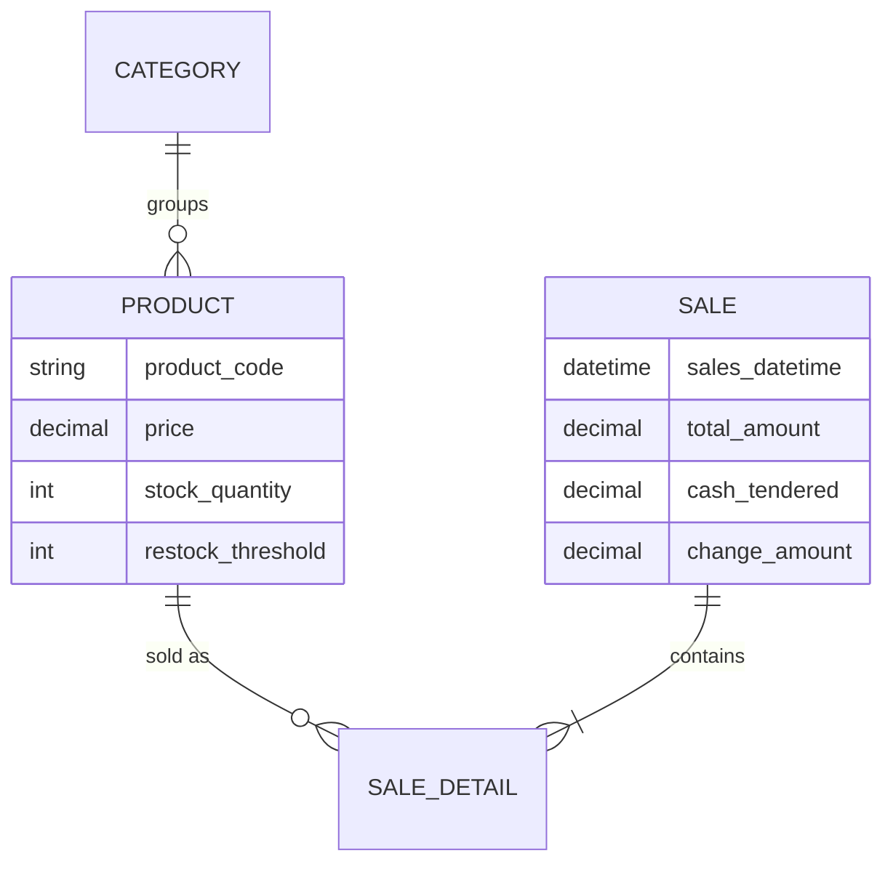

<div align="center">


**A Django point of sale for the university bookstore: books, supplies and uniforms.**


</div>

---

## ✨ Features

| | Page | What it does |
| --- | --- | --- |
| 🏠 | **Dashboard** | Today's sales and stock overview |
| 🛒 | **POS** | Ring up items, take cash and compute change automatically |
| 🧾 | **Receipts** | A printable receipt for every sale |
| 📦 | **Products** | Categories (`BOOK`, `SUP`, `UNI`…), auto product codes and active/inactive flags |
| ⚠️ | **Restock alerts** | A threshold per product warns you before stock runs out |
| 📜 | **Transactions** | Full sales history with status tracking |
| 📈 | **Reports** | Sales summaries for the store |

## 🗃️ Data model



## 🚀 Run it locally

```bash
git clone https://github.com/Daniel2525-ui/fsuu-bookstore-system.git
cd fsuu-bookstore-system
python -m venv venv
source venv/bin/activate     # Windows: venv\Scripts\activate
pip install -r requirements.txt
python manage.py migrate
python manage.py runserver
```

---

<div align="center">

Built by **[Erle Daniel Sudario](https://github.com/Daniel2525-ui)**


</div>
